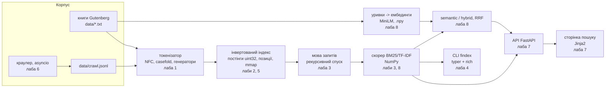
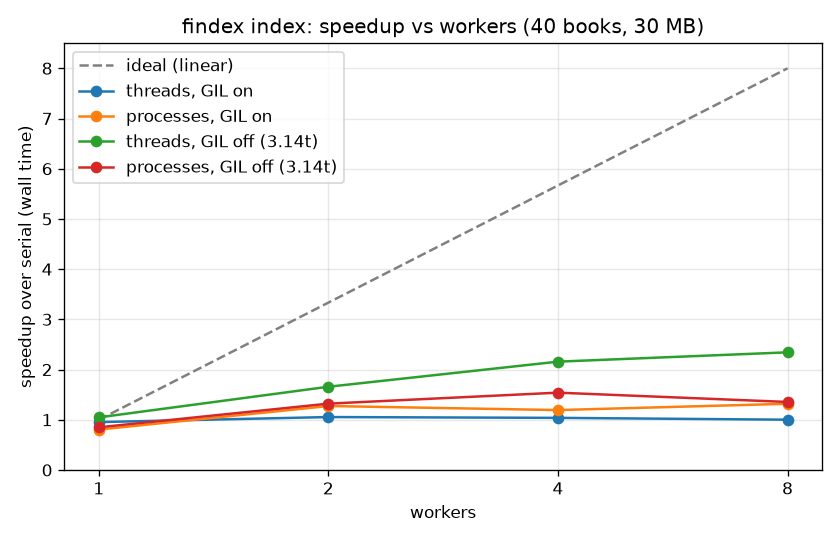

# findex

**Пошуковий рушій, написаний з нуля на Python: потоковий токенізатор, інвертований
індекс, BM25 на NumPy, мова запитів, семантичний і гібридний пошук, вебсервіс.**

**Спробувати: https://findex-n3kg.onrender.com** · [API](https://findex-n3kg.onrender.com/docs) · [](https://github.com/JekaMor/findex/actions/workflows/ci.yml)


| 40 книг · 5,3 млн слів · 34 429 уривків | 579 запитів/с на суміші різних запитів (p95 244 мс, 4 воркери); до профілювання було 6 | у 42 рази швидше ранжування на NumPy, у 15 разів швидший новий запит зі сніпетами |
|---|---|---|

> Безкоштовний план Render присипляє сервіс після 15 хвилин без запитів: перше
> відкриття після паузи може тривати до хвилини.

## Що вміє

- **Мова запитів:** `sea AND (pirate OR treasure) NOT whale "dead man"`: AND, OR, NOT,
  дужки, точні фрази за позиціями слів.
- **Ранжування:** BM25 або TF-IDF; ранжування за рядками масивів NumPy, топ-k через
  `np.argpartition`.
- **Три режими:** `keyword` (BM25 над булевим запитом), `semantic` (ембединги
  all-MiniLM-L6-v2, документ оцінюється за найкращим уривком), `hybrid` (обидва
  списки, злиті через Reciprocal Rank Fusion).
- **Сніпети** з підсвіткою, які читають з диска лише 64 КБ навколо місця, куди
  вказують позиції в індексі.
- **CLI** `findex`: `index`, `search`, `stats`, `crawl`, `embed`, `serve`.
- **Вебсервіс** на FastAPI: JSON API, сторінка пошуку, `/health`, Docker-образ,
  розгорнутий на Render.
- **Краулер** на asyncio, що поважає `robots.txt`, із лімітами на хост.
- **Паралельна збірка** індексу процесами, з підтримкою free-threaded Python 3.14t.

## Швидкий старт

```bash
uv tool install https://github.com/JekaMor/findex/releases/download/v1.0.0/findex-1.0.0-py3-none-any.whl
# або з клону: uv sync --extra semantic

python scripts/download_corpus.py data          # 40 книг з Project Gutenberg
findex index data/ --out index.bin              # ~5 с на 8 процесах
findex search index.bin 'sea AND (pirate OR treasure) NOT whale "dead man"'
findex embed index.bin                          # уривки -> ембединги (CPU, ~30 хв)
findex search index.bin "an undead nobleman who feeds on the living" --mode semantic
findex serve --index index.bin                  # http://127.0.0.1:8000

findex crawl https://docs.python.org/3/library/ --max-pages 200   # свій корпус з сайту
findex index data/crawl.jsonl -o web.bin
```

Docker: `docker build -t findex . && docker run --rm -p 8000:8000 findex` (індекс,
модель і ембединги вже в образі).

## Як влаштовано



- **Корпус** читається потоком, по документу за раз (`corpus.py`): тека `.txt` або
  JSONL від краулера.
- **Індекс:** слово → `doc_ids`, `tfs`, позиції як масиви `uint32`; на диску —
  JSON-заголовок і сирі масиви, що відкриваються через `mmap` без копіювання
  (`store.py`). Збірка ділиться на шматки й зливається (`parallel.py`).
- **Пошук:** запит розбирається в дерево (`query.py`), дерево дає множину документів
  злиттям відсортованих списків (`boolean.py`), скорер ранжує їх (`search.py`,
  `scoring.py`).
- **Семантика:** документи ріжуться на уривки по ~200 слів (`chunks.py`), ембединги
  уривків лежать у `.npy`, пошук — це одне множення `vectors @ q` (`semantic.py`).
- **Інтерфейси:** CLI (`cli.py`), вебсервіс (`web/`).

## Виміри (лаби 1–8)

Усе міряно на одному ноутбуці: Intel Core i5-1035G1 (4 ядра / 8 потоків, 15 Вт),
Windows 10, CPython 3.14. Як міряли і що це означає — у [звітах лаб](docs/labs.md) і
в [profiling.md](docs/profiling.md).

**Лаба 1. Генератори проти списків** (статистика корпусу, 5,3 млн токенів)

| Версія | Пікова пам'ять | Час |
|---|---|---|
| списки (eager) | 321,7 МіБ | 15,37 с |
| генератори (lazy) | 52,1 МіБ | 14,73 с |

**Лаба 2. Як зберігати постінги** (345 тисяч постінгів)

| Постінги | Індекс у пам'яті | Pickle | Завантаження |
|---|---|---|---|
| `list[Posting]`, звичайний dataclass | 44,4 МіБ | 7,9 МіБ | 0,44 с |
| `list[Posting]`, `slots=True` | 31,2 МіБ | 5,9 МіБ | 1,12 с |
| пари `array('I')` | 28,4 МіБ | 7,6 МіБ | 0,26 с |
| з позиціями: об'єкти / масиви | 248,0 / 49,8 МіБ | 27,3 / 27,8 МіБ | — |

Формати: pickle 5,9 МіБ і 1,17 с на завантаження проти власного бінарного 4,5 МіБ і 0,30 с.
Merge проти set на списках по 40 документів: 12–13 мкс проти 8–9 мкс; на таких коротких
списках вбудований `set` на C перемагає.

**Лаба 3. BM25 проти TF-IDF**

| Перевірка | BM25 | TF-IDF |
|---|---|---|
| рідкісне `yearling` проти частого `love` | книги з `yearling` на 1–2 місцях | Karamazov (лише `love`) на 2-му |
| приріст від 20-го входження `whale` | +0,017 | +1,492 (як від першого) |
| `absentees` 1 раз у книзі на 6,5 тис. і на 570 тис. слів | 4,89 проти 1,12 | 3,00 = 3,00 |
| precision@5, 10 запитів | 0,34 | 0,30 |

**Лаба 4.** Pyright strict без помилок, 181 тест, 6 властивостей Hypothesis, покриття 98%.
Зараз тестів 336.

**Лаба 5. Паралельна збірка індексу** (40 книг; серійно 6,52 с)

| Python | Виконавець | Найкращий wall | Прискорення | CPU |
|---|---|---|---|---|
| 3.14 з GIL | потоки, 8 | 6,51 с | 1,00× | 6,56 с |
| 3.14 з GIL | процеси, 8 | 4,94 с | 1,32× | 29,52 с |
| 3.14t без GIL | потоки, 8 | 2,78 с | 2,34× | 15,95 с |



Спільний `Counter` у 8 потоках без блокування: 0 втрачених оновлень з GIL, 31–32 тисячі
з 822 тисяч без GIL.

**Лаба 6. Краулер** (docs.python.org, 200 сторінок)

| Одночасних запитів | Ліміт на хост, пауза | Сторінок/с | Пік RSS |
|---|---|---|---|
| 1 | 1, 0,05 с | 8,6 | 45 МіБ |
| 5 | 5, 0,05 с | 15,6 | 46 МіБ |
| 20 | 20, 0,05 с | 16,2 | 46 МіБ |
| 20 | 2, 0,25 с (типово) | 3,9 | 46 МіБ |

**Лаба 7. Вебсервіс під навантаженням** (`oha`, `/search?q=white+whale&k=10`)

| Варіант | Запитів/с | p50 | p95 | p99 |
|---|---|---|---|---|
| 1 воркер, `async def` | 742 | 63 мс | 95 мс | 103 мс |
| 1 воркер, `def` | 420 | 111 мс | 161 мс | 177 мс |
| 4 воркери | 1 164 | 42 мс | 69 мс | 84 мс |
| Render, безкоштовний план | 60 | 305 мс | 410 мс | 606 мс |

20 важких запитів одночасно: `/health` чекав 6,0 с з `async def`, 3,9 с з `def`, 1,3 с з
4 воркерами.

**Те саме після лаби 8** (`oha -z 20s -c 50`; «суміш» — 225 різних запитів
`--rand-regex-url "q=(white|sea|love|…)+(whale|captain|heart|…)"`, сирі звіти в `bench/oha-lab8-*.json`)

| Код | Воркерів | Запити | Запитів/с | p50 | p95 | p99 |
|---|---|---|---|---|---|---|
| лаба 7 | 1 | `white whale` щоразу (кеш сніпетів) | 370 | 105 мс | 131 мс | 153 мс |
| лаба 7 | 1 | суміш | **6** | 9 617 мс | 17 900 мс | 18 216 мс |
| лаба 8 | 1 | `white whale` щоразу | 293 | 202 мс | 250 мс | 264 мс |
| лаба 8 | 1 | суміш | **223** | 193 мс | 443 мс | 893 мс |
| лаба 8 | 4 | `white whale` щоразу | 937 | 53 мс | 78 мс | 97 мс |
| лаба 8 | 4 | суміш | **579** | 65 мс | 244 мс | 368 мс |
| лаба 8 | 1 | `mode=semantic`, один запит | 166 | 274 мс | 318 мс | 2 081 мс |
| лаба 8 | 1 | `mode=hybrid`, суміш | 125 | 294 мс | 956 мс | 2 378 мс |
| лаба 8, Render (0,1 CPU, `-c 20`) | 1 | `white whale` щоразу | 52 | 399 мс | 499 мс | 524 мс |
| лаба 8, Render (0,1 CPU, `-c 20`) | 1 | суміш | 7,6 | 2 866 мс | 4 566 мс | 4 810 мс |

Число лаби 7 (420 запитів/с) вимірювало кеш: один і той самий запит, сніпети якого
вже лежали в `lru_cache`. Новий запит у лабі 7 коштував 230 мс, тому суміш різних
запитів дає 6 запитів/с. Після лаби 8 новий запит коштує ~11 мс. Кеш сніпетів
лишився (його випадково прибрало переписування, і він повернувся, коли `oha`
показав просідання), але тепер він потрібен лише популярним запитам. Пам'ять одного
воркера з моделлю та ембедингами — 297 МБ.

**Лаба 8. Профілювання, NumPy, семантика**

| До і після | Було | Стало |
|---|---|---|
| пошук зі сніпетами, на запит | 300–366 мс | 21,6–22,5 мс |
| ранжування, на запит | 0,5 мс | 0,2 мс |
| імпорт `findex.cli` | 0,97 с | 0,60 с |

| Індекс | Запит | Lab 3 | NumPy | Прискорення |
|---|---|---|---|---|
| 40 книг | `the` | 10,064 мс | 0,065 мс | 155× (переважно — не декодувати позиції) |
| 40 книг, без позицій | `the` | 0,104 мс | 0,072 мс | 1,4× |
| 34 429 уривків | `the` | 102,471 мс | 3,249 мс | 31,5× |
| 34 429 уривків | `sea OR ship OR captain` | 10,801 мс | 0,255 мс | 42,4× |
| будь-який | рідкісне слово | 0,012–0,017 мс | 0,045–0,074 мс | 0,2–0,3× |

**Якість трьох режимів** (`scripts/evaluate_modes.py`: 10 запитів лаби 3 і 5 переказів
сюжету без ключових слів книги; «перший релевантний» — позиція потрібної книги в
топ-40)

| Запит | Релевантних | P@5 keyword | P@5 semantic | P@5 hybrid | 1-й релевантний: keyword / semantic / hybrid |
|---|---|---|---|---|---|
| `sea OR ship OR voyage OR captain` | 3 | 0,6 | 0,6 | 0,6 | 1 / 1 / 1 |
| `pirate OR treasure` | 3 | 0,4 | 0,4 | 0,4 | 1 / 1 / 1 |
| `sovereign OR commonwealth OR power` | 3 | 0,4 | **0,6** | **0,6** | 1 / 1 / 1 |
| `slavery OR negro OR freedom` | 2 | 0,4 | 0,2 | 0,4 | 1 / 1 / 1 |
| `scientist OR experiment OR transformation` | 3 | 0,2 | **0,4** | **0,4** | 3 / 2 / 3 |
| `monster OR creature` | 2 | 0,4 | 0,2 | 0,4 | 1 / 4 / 1 |
| `marriage OR fortune OR estate` | 3 | **0,4** | 0,2 | 0,2 | 1 / 4 / 1 |
| `vampire OR blood OR count` | 1 | 0,2 | 0,2 | 0,2 | 1 / 1 / 1 |
| `martians OR invasion` | 1 | 0,2 | 0,2 | 0,2 | 1 / 1 / 1 |
| `war OR army OR napoleon` | 1 | 0,2 | 0,2 | 0,2 | 1 / 1 / 1 |
| *an obsessed sailor chasing an enormous sea mammal across the oceans* (Moby Dick) | 1 | 0,2 | 0,2 | 0,2 | 1 / 1 / 1 |
| *an undead nobleman who feeds on the living and sleeps in his grave by day* (Dracula) | 1 | 0,2 | 0,2 | 0,2 | 5 / 4 / 4 |
| *a student stitches together a body from corpses and brings it to life* (Frankenstein) | 1 | 0,0 | 0,0 | 0,0 | 25 / 15 / 15 |
| *beings from another world land in the English countryside and destroy everything* (War of the Worlds) | 1 | 0,2 | 0,2 | 0,2 | 2 / 3 / **1** |
| *a boy escapes his drunken father and travels downstream with a fugitive* (Huckleberry Finn) | 1 | 0,0 | 0,0 | 0,0 | 10 / 11 / 11 |
| **середнє, 10 запитів лаби 3** | | 0,34 | 0,32 | **0,36** | MRR 0,93 / 0,80 / 0,93 |
| **середнє, 5 переказів** | | 0,12 | 0,12 | 0,12 | MRR 0,37 / 0,35 / **0,48** |

Що з цього видно. На запитах лаби 3 семантичний пошук сам по собі трохи гірший за
BM25: запити складено зі слів, і BM25 саме для цього й зроблений. Але він знаходить
інші книги. `sovereign OR commonwealth OR power` і `scientist OR experiment` він
виграє, бо шукає тему, а не слова, а `marriage OR fortune` і `monster OR creature`
програє. Гібрид бере краще з обох і дає найвищий P@5 (0,36). На переказах P@5 не
розрізняє режими: релевантна книга одна, тож P@5 буває лише 0 або 0,2. Позиції
показують більше: гібрид піднімає War of the Worlds на 1-ше місце, а Dracula і
Frankenstein — вище, ніж keyword. Чудес немає. Модель порівнює запит з уривками
по 200 слів, а переказ сюжету описує книгу цілком, тож Frankenstein опиняється
лише на 15-му місці. Keyword тут теж не безпорадний, бо OR з усіх слів переказу
ловить випадкові збіги. 15 запитів — мало, щоб назвати різницю між 0,34 і 0,36
значущою.

## Обмеження

- **Корпус малий:** 40 книжок. Ранжування на NumPy окуповується лише на довгих
  списках постінгів; на книжковому індексі виграш здебільшого дає те, що не
  декодуються позиції. На 34 тисячах уривків це вже 30–40×.
- **Немає оновлення індексу:** його можна лише перебудувати. Немає стемінгу і
  стоп-слів, тож `whales` не знаходить `whale`.
- **Семантичний пошук — повний перебір** `vectors @ q`: швидко на десятках тисяч
  уривків, але для мільйонів потрібен приблизний пошук найближчих сусідів (HNSW,
  FAISS). Векторизація на CPU ноутбука повільна: ~20 уривків/с, 30 хвилин на корпус.
  Модель англомовна.
- **Безкоштовний Render:** 0,1 CPU і 512 МБ. Звідси 60 запитів/с і засинання без
  трафіку. Модель і ембединги займають там помітну частину пам'яті.
- **Сніпети** знаходять місце за позиціями, а потім вгадують байтовий зсув у файлі.
  На цьому корпусі за 2000 сніпетів оцінка не промахнулася жодного разу, а якщо
  промахнеться, працює запасний шлях через усю книгу.
- **Оцінка якості** — 15 запитів, розмічених мною. Цього досить, щоб побачити
  різницю між режимами, але це не бенчмарк.

## Де що лежить

| Шлях | Що там |
|---|---|
| `src/findex/` | пакет: `corpus`, `tokenize`, `index`, `model`, `store`, `boolean`, `query`, `scoring`, `search`, `snippets`, `parallel`, `chunks`, `semantic`, `crawler/`, `web/`, `cli` |
| `tests/` | pytest, Hypothesis, `pytest-benchmark` |
| `scripts/` | завантаження корпусу і всі бенчмарки, з яких узято таблиці |
| `bench/` | сирі результати бенчмарків (JSON), логи обходів, графік |
| `docs/labs.md` | докладні звіти лаб 1–7 |
| `docs/profiling.md` | профілювання лаби 8: гіпотези до змін і результати після |
| `docs/*.svg` | flame graph-и py-spy |
| `eval/queries.toml` | розмічені запити для precision@5 |
